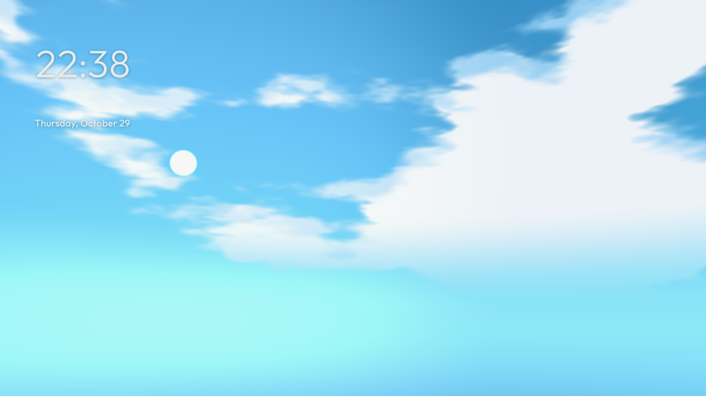

# Aerie

Live wallpapers for Pop!_OS (COSMIC), like Wallpaper Engine, on your desktop and your lock screen.

- Play 3D scenes you export from Blender (`.glb`), with their camera, lights and animations. They move with your mouse. See [docs/BLENDER.md](docs/BLENDER.md).
- Use your Wallpaper Engine wallpapers from the Steam Workshop, or add a Wallpaper Engine folder or `.zip`. Video, web and picture wallpapers play in full; scene wallpapers show their picture layers.
- Add your own videos, pictures, web pages, web sites and Lively web wallpapers.
- Press **Super+D** for the hub: quick controls, today, stats, clipboard history, apps, a wallpaper carousel and power.
- Turn on the live lock screen if you want your wallpaper there too.
- Change everything in **Aerie Studio**, with a live preview. **Ctrl+K** searches every page, action and wallpaper.



## What you need

- Pop!_OS 24.04 with COSMIC (other Wayland desktops with layer-shell work for the wallpaper and hub)
- Optional: `wl-clipboard` for clipboard history, `gstreamer1.0-libav` for more video formats. The installer adds both when it can.

## Install, update, uninstall

| | How |
| --- | --- |
| **Install** | `curl -fsSL https://jayswansocool48.github.io/aerie/install.sh \| bash`, or `./install.sh` in this folder |
| **Open** | Press **Super** and type **Aerie** to open Aerie Studio. Turn on Super+D in Studio → Hub. |
| **Update** | The COSMIC Store updates it with your other apps, or use Studio → Settings → **Check for updates** |
| **Uninstall** | Studio → Settings → **Uninstall Aerie** removes the app, all its data and the hub shortcuts, and gives you COSMIC's own lock screen and look back. The COSMIC Store and `./install.sh --uninstall` work too. |
| **Not working?** | Run `./install.sh --check` and send the output |

Aerie ships as a `.deb`, not a Flatpak, because COSMIC only lets apps outside the Flatpak sandbox draw on the desktop layer and lock the screen.

## The lock screen

Studio → Lock screen → **Use Aerie as my lock screen** asks for your password once. Aerie then sets COSMIC's lock screen program aside with `dpkg-divert` and puts a small switch in its place. The switch starts Aerie's lock screen for you and COSMIC's for everyone else and for the login screen. PAM checks your password, as at login, and Aerie never stores it. If Aerie's lock screen crashes, your session stays locked; after 3 crashes in 2 minutes COSMIC's lock screen takes over. Turning the option off or uninstalling puts COSMIC's file back.

## For developers

```bash
./bin/aerie                     # the whole app from this folder (run tools/build-deb.sh once for layer-shell)
python3 tests/test_library.py && python3 tests/test_wetex.py && python3 tests/test_replies.py && node tests/test_motion.mjs
```

To release, change `VERSION` and `__version__` in `aerie/__init__.py`, add a `<release>` to the metainfo file and push to main. The Release workflow builds the `.deb`, publishes it and refuses a tag that doesn't match `VERSION`.

## Credits and licenses

- Aerie: MIT, see `LICENSE`
- [three.js](https://threejs.org) r169, [gtk4-layer-shell](https://github.com/wmww/gtk4-layer-shell) 1.3.0 and the [meshoptimizer](https://github.com/zeux/meshoptimizer) decoder (MIT); the [Draco](https://github.com/google/draco) decoder (Apache 2.0)
- Fonts: [Outfit](https://github.com/Outfitio/Outfit-Fonts) and [Dela Gothic One](https://github.com/syakuzen/DelaGothic), SIL Open Font License, bundled in `web/fonts/`
- Aerie synthesizes its sounds in code and bundles no audio. The icon and preset previews are original.
- Wallpaper Engine belongs to Wallpaper Engine Team / Kristjan Skutta, and Lively to rocksdanister. Aerie isn't affiliated with either and only reads wallpapers you have.

See `PRIVACY.md`, `TERMS.md` and `COMPLIANCE.md`.
