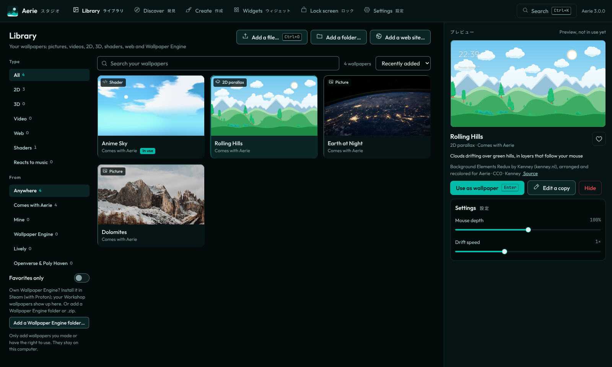

# Aerie

Live wallpapers for Pop!_OS (COSMIC), in the spirit of Wallpaper Engine. Play 2D, 3D, video, shader, web and music-reactive wallpapers on your desktop and your lock screen, import the ones you have, and make your own.



## Wallpaper types

| Type | What you add | Notes |
|---|---|---|
| Picture | `.jpg`, `.png`, `.webp`, `.avif`, `.svg`, animated `.gif` and `.apng` | |
| Video | `.mp4`, `.webm`, `.mkv`, `.mov` | Install `gstreamer1.0-libav` for more formats |
| 2D parallax | A folder with `parallax.json` and its layers, or build one in Studio | Layers slide with your mouse, sway on their own and can pulse with music |
| 3D model | `.glb` or `.gltf`, for example from Blender | Plays the scene's camera, lights and animations. See [docs/BLENDER.md](docs/BLENDER.md) |
| 3D scene | A `stage.json`, built in Studio | A 360° sky from Poly Haven with 3D models placed in it, a slow camera orbit and fog |
| Shader | A Shadertoy-style `.glsl` / `.frag` file, or write one in Studio | `iTime`, `iResolution`, `iMouse`, `iChannel0–3`; one comment line makes it hear music |
| Web | An `.html` page, a folder, a Lively wallpaper or a web address | Runs in a sandbox with a throw-away browser profile |
| Wallpaper Engine | Your Steam Workshop subscriptions, a project folder or a `.zip` | Video, web and picture wallpapers play in full, with their settings. Scene wallpapers play their picture layers with parallax |

Drag any of these onto Studio, or use **Add a file…** (Ctrl+O). The file formats are in [docs/FORMATS.md](docs/FORMATS.md).

## Find and make wallpapers

- **Discover** searches public-domain pictures on Openverse, and free 360° skies and 3D models on Poly Haven. It stays offline until you turn it on, and every download keeps its credit.
- **Create** has an AI that finds a picture, writes a shader or builds a 3D scene from what you describe, and can change it after ("slower clouds", "add a bench"). It runs on Ollama on your computer, or on Claude or ChatGPT with your own API key. With ChatGPT it can also paint a picture.
- You can also write a shader with a live preview, stack PNG layers into a parallax, or place Poly Haven models under a sky yourself.

## Also in Aerie

- **Widgets** over your wallpaper: clock, date, notes, to-dos, now playing, system stats, quick links and more. Drag them on the desktop or in Studio.
- **Live lock screen**, if you want your wallpaper there too.
- **Right-click the desktop** for the wallpaper menu, widgets, pause and Studio.
- Aerie pauses while a window covers the desktop or you're on battery.
- **Ctrl+K** in Studio searches every page, action and wallpaper.

## What you need

- Pop!_OS 24.04 with COSMIC (other Wayland desktops with layer-shell work for the wallpaper)
- For music-reactive wallpapers: `pulseaudio-utils` or `pipewire-bin` (Pop!_OS has one already). For more video formats: `gstreamer1.0-libav`. The installer adds them when it can.

## Install, update, uninstall

| | How |
| --- | --- |
| **Install** | `curl -fsSL https://jayswansocool48.github.io/aerie/install.sh \| bash`, or `./install.sh` in this folder |
| **Open** | Press **Super** and type **Aerie** to open Aerie Studio |
| **Update** | The COSMIC Store updates it with your other apps, or use Studio → Settings → **Check for updates** |
| **Uninstall** | Studio → Settings → **Uninstall Aerie** removes the app and all its data, and gives you COSMIC's own lock screen back. The COSMIC Store and `./install.sh --uninstall` work too. |
| **Not working?** | Run `./install.sh --check` and send the output |

Aerie ships as a `.deb`, not a Flatpak, because COSMIC only lets apps outside the Flatpak sandbox draw on the desktop layer and lock the screen.

## The lock screen

Studio → Lock screen → **Use Aerie as my lock screen** asks for your password once. Aerie then sets COSMIC's lock screen program aside with `dpkg-divert` and puts a small switch in its place. The switch starts Aerie's lock screen for you and COSMIC's for everyone else and for the login screen. PAM checks your password, as at login, and Aerie never stores it. If Aerie's lock screen crashes, your session stays locked; after 3 crashes in 2 minutes COSMIC's lock screen takes over. Turning the option off or uninstalling puts COSMIC's file back.

## For developers

```bash
./bin/aerie                     # the whole app from this folder (run tools/build-deb.sh once for layer-shell)
for t in tests/test_*.py; do python3 "$t" || break; done && node tests/test_motion.mjs
```

`tests/run_under_sway.sh` runs the real app in a headless sway session and takes screenshots; CI runs it on every push.

To release, change `VERSION` and `__version__` in `aerie/__init__.py`, add a `<release>` to the metainfo file and push to main. The Release workflow builds the `.deb`, publishes it and refuses a tag that doesn't match `VERSION`.

## Credits and licenses

- Aerie: MIT, see `LICENSE`
- [three.js](https://threejs.org) r169 with its loaders, [gtk4-layer-shell](https://github.com/wmww/gtk4-layer-shell) 1.3.0, the [meshoptimizer](https://github.com/zeux/meshoptimizer) decoder and [Phosphor icons](https://phosphoricons.com) (MIT); the [Draco](https://github.com/google/draco) decoder (Apache 2.0)
- Fonts: [Outfit](https://github.com/Outfitio/Outfit-Fonts) and [JetBrains Mono](https://github.com/JetBrains/JetBrainsMono), SIL Open Font License, bundled in `web/fonts/`
- Theme "Teal Mist" by serafimcloud, and the filter chips and slider adapted from components by ddoemonn and halaska-studio, all on [21st.dev](https://21st.dev)
- Bundled wallpapers: see [web/wallpapers/README.md](web/wallpapers/README.md). All are CC0 or public domain.
- Discover uses [Openverse](https://openverse.org) and [Poly Haven](https://polyhaven.com). Aerie isn't affiliated with either.
- Wallpaper Engine belongs to Wallpaper Engine Team / Kristjan Skutta, and Lively to rocksdanister. Aerie isn't affiliated with either and only reads wallpapers you have.

See `PRIVACY.md`, `TERMS.md` and `COMPLIANCE.md`.
